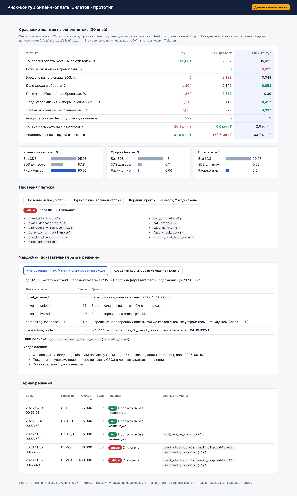

# payment-antifraud — риск-контур онлайн-оплаты билетов (прототип)

Прототип к отклику на технологическую задачу Astana Hub **«Антифрод платежей и управление чарджбэками при онлайн-оплате билетов»** (ТОО Ticketon Events). Основной результат по ТЗ — проектный документ. Прототип показывает, что описанная в нём логика работает и её можно проверить на данных.

> **Все данные вымышленные.** Поток платежей сгенерирован (`app/synthetic.py`), в него специально заложены кардинг, card testing и «дружественный» фрод с разметкой `label`. Это не статистика Ticketon. Поведение эмитентов и покупателей в симуляции задано допущениями (`ASSUMPTIONS` в `app/simulate.py`). Результаты подходят для сравнения политик между собой, но не являются прогнозом.

## Что умеет

| Пункт ТЗ | Где в прототипе |
|---|---|
| 1. Точки риск-решений и условия 3-D Secure | `POST /v1/payments/score` → `allow_frictionless` / `challenge_3ds` / `challenge_3ds_strict` / `decline`; обратная связь `POST /v1/payments/auth-result` |
| 2. Риск-скоринг: сигналы, пороги, действия | `app/engine.py`, веса и пороги вынесены в `policy.yaml`; в ответе есть балл, уровень и причины (reason codes) |
| 3. Защита от card testing | скорости по устройству, IP и BIN за 10 мин, временные блокировки, «режим щита» при всплеске отказов эмитента |
| 4. Работа с чарджбэками | `app/chargebacks.py`: классификация кода, пакет доказательств (3DS/ECI, скан билета на входе, Visa CE 3.0), решение «оспорить/принять», уведомления, серый и чёрный списки, аннулирование билета |
| 5. Метрики | `GET /v1/metrics/simulation`: конверсия, ложные отклонения, доля фрода в обороте, доля чарджбэков, отказы эмитента, потери |

Карточные данные: PAN не принимается и не хранится, используются только токен провайдера, BIN и последние 4 цифры.

## Результат симуляции (30 дней, ≈28 тыс. попыток, вымышленные данные)

| Метрика | Без 3DS | 3DS для всех | Риск-контур |
|---|---:|---:|---:|
| Конверсия честных покупателей | 95,08% | 87,21% | 95,02% |
| Доля фрода в обороте | 1,30% | 0,17% | 0,06% |
| Доля чарджбэков | 1,38% | 0,35% | 0,39% |
| Авторизаций card testing у эквайера | 999 | 0 | 9 |
| Потери на чарджбэках и комиссиях | 20,1 млн ₸ | 0,6 млн ₸ | 2,6 млн ₸ |
| Недополученная выручка от честных | 61,6 млн ₸ | 153,6 млн ₸ | 63,7 млн ₸ |

Политика «3DS для всех» даёт минимальные прямые потери, но отсекает около 8% честных покупателей. Риск-контур сохраняет конверсию на уровне «без 3DS» и почти полностью убирает фрод. Синтетический фрод легче отделить от честных покупок, чем реальный, поэтому на данных Ticketon разрыв будет меньше.

## Документы

- `docs/Predlozhenie_antifrod_Ticketon.pdf` — предложение и проектный документ
- `docs/Primer_rezultata_antifrod.pdf` — пример результата со скриншотами



## Запуск

**Windows:** дважды щёлкнуть `run.bat`. Скрипт создаст `.venv`, установит зависимости, прогонит тесты и откроет панель http://127.0.0.1:8000.

**Вручную:**
```bash
python -m venv .venv && .venv\Scripts\activate    # Linux/macOS: source .venv/bin/activate
pip install -r requirements.txt
python -m pytest -q
python -m uvicorn app.api:app --port 8000
```

**Docker:**
```bash
docker compose up --build
```

- Панель: http://127.0.0.1:8000, Swagger: http://127.0.0.1:8000/docs
- Сравнение политик в консоли: `python -m app.simulate`
- Выборка данных в CSV: `python scripts/generate_data.py` → `data/sample_attempts.csv`

## Структура

```
app/
  engine.py       риск-движок: card testing → жёсткие правила → скоринг → маршрутизация
  chargebacks.py  классификация, доказательная база, решение, списки риска
  simulate.py     сравнение политик no_3ds / 3ds_all / risk_based
  synthetic.py    генератор вымышленного потока с аномалиями
  api.py          FastAPI + демо-сценарии
  dashboard.html  панель
policy.yaml       веса сигналов, пороги, параметры card testing и чарджбэков
tests/            автотесты (14)
```

## Калибровка на данных Ticketon

Значения в `policy.yaml` стартовые. Перед запуском их нужно подобрать на истории заказов за 6–12 месяцев с метками фрода и чарджбэков. Порядок: (1) прогнать историю через движок в «теневом режиме», не влияя на оплату; (2) подобрать веса и границы уровней так, чтобы доля челленджей у честных покупателей не превышала целевого значения; (3) провести A/B-тест на части трафика. После накопления размеченных данных правила дополняются ML-моделью (градиентный бустинг), а правила остаются для объяснимости решений и аварийного отката.

## Что не проверено

- Интеграция с реальным платёжным шлюзом, 3DS-сервером и эквайером: в прототипе они смоделированы.
- Данные Ticketon: не использовались, все пороги нуждаются в калибровке.
- Сборка Docker-образа в среде разработки не запускалась (Dockerfile стандартный).
- Хранилище в памяти: в продакшене скользящие окна и списки переносятся в Redis, журнал решений — в PostgreSQL.

## Лицензия

Все права защищены, см. [LICENSE](LICENSE).
